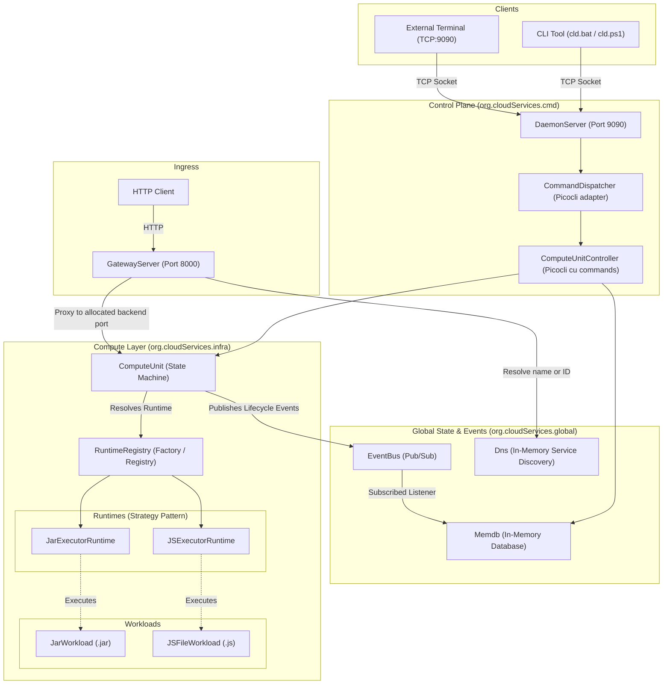
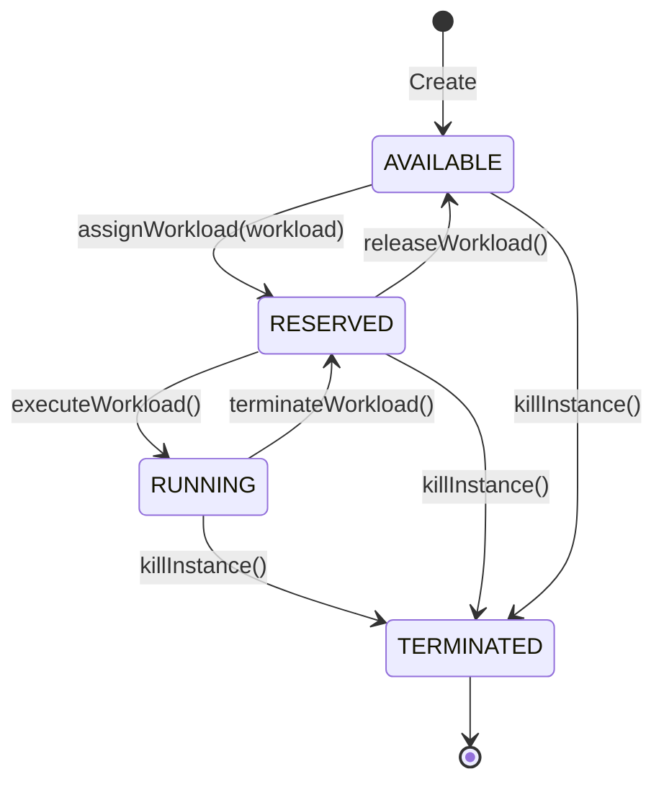

# CLDPlatform (Cloud Service)

A lightweight, extensible cloud compute and workload orchestration daemon built in Java 22.

---

## High-Level Architecture

The system decouples workload definition, execution runtimes, compute state management, and command dispatching via a clean event-driven, registry-based architecture:



---

## Core Components

### 1. Compute Unit & Lifecycle (`org.cloudServices.infra.computeUnit`)
A **`ComputeUnit`** represents an isolated virtual compute allocation (similar to an EC2 instance or container).
- Manages an internal state machine: `AVAILABLE` $\rightarrow$ `RESERVED` $\rightarrow$ `RUNNING` $\rightarrow$ `STOPPED` $\rightarrow$ `TERMINATED`.
- Handles workload assignment, execution (`executeWorkload()`), termination (`terminateWorkload()`), releasing, and teardown (`killInstance()`).
- Emits lifecycle events (`COMPUTE_UNIT_CREATED`, `COMPUTE_UNIT_KILLED`, etc.) to the `EventBus`.

### 2. Runtime Strategy & Factory Registry (`org.cloudServices.infra.runtimes`)
Execution runtimes implement the Strategy Pattern to insulate `ComputeUnit` from specific execution engines:
- **`RuntimeInterface`**: Contract defining `boot()`, `submit()`, and `stop()`.
- **`JarExecutorRuntime`**: Manages underlying OS processes via `ProcessBuilder`, executing executable JARs and capturing process PIDs.
- **`JSExecutorRuntime`**: Runtime for executing JavaScript workloads.
- **`RuntimeRegistry`**: Static factory registry mapping `Workload` class types (e.g. `JarWorkload`, `JSFileWorkload`) to runtime creator factories. Allows plugging in new runtimes (Python, Docker, WASM) without modifying `ComputeUnit`.

### 3. Global Subsystems (`org.cloudServices.global`)
- **`Memdb`**: In-memory database tracking active compute units. Subscribes directly to `EventBus` to register newly created units and deregister killed units automatically.
- **`EventBus`**: Thread-safe publisher-subscriber message broker (`CopyOnWriteArrayList`) broadcasting system events.
- **`Dns`**: In-memory registry mapping a reserved compute unit's ID and optional name to its backend address. This is application-level service discovery, not an operating-system DNS entry.
- **`GatewayServer`**: HTTP ingress on port `8000`. It resolves the first path segment as a compute unit ID or name and proxies the remaining path to that workload's dynamically allocated backend port.

### 4. Command Daemon & CLI (`org.cloudServices.cmd`)
- **`DaemonServer`**: Multi-threaded TCP daemon on port `9090` listening for external terminal commands.
- **`CommandDispatcher`**: Reflection-based scanner that discovers controllers annotated with `@CLDCommand` and actions annotated with `@CLDAction`.
- **`ComputeUnitController`**: Controller exposing `cld cu` CLI operations to external clients.
- **`cld.bat` & `cld.ps1`**: Native command-line scripts providing a seamless CLI experience.

---

## Compute Unit State Machine



---

## CLI Command Reference

All commands can be run via CMD (`cld ...`) or PowerShell (`.\cld ...`):

| Command | Arguments | Description |
| :--- | :--- | :--- |
| `cld --help` | None | Displays top-level CLI help. |
| `cld cu --help` | None | Displays compute-unit commands and aliases. |
| `cld cu list` | None | Lists each active compute unit once, including its name, state, PID, and workload. |
| `cld cu create` | Optional: `--capacity <MICRO\|MEDIUM\|LARGE\|ULTRA>`, `--name <name>`, `[jar\|js] <path> [args...]`, or `docker <image> port=<port> [name=<container>] [tag=<tag>] [env.<key>=<value>...]` | Creates a new compute unit, optionally with a workload. Capacity defaults to `MICRO`. |
| `cld cu assign` | `<unitId> [jar\|js] <path>` or `<unitId> docker <image> port=<port> [name=<container>] [tag=<tag>] [env.<key>=<value>...]` | Assigns a workload to an available unit and boots its runtime. |
| `cld cu run` | `<unitId>` | Submits and executes the workload, capturing the operating system PID. |
| `cld cu execute` | `<unitId>` | Alias for `run`. |
| `cld cu status` | `<unitId>` | Displays metadata including the allocated backend port when available. |
| `cld cu stop` | `<unitId>` | Terminates the active workload process. |
| `cld cu terminate` | `<unitId>` | Alias for `stop`. |
| `cld cu release` | `<unitId>` | Clears the workload and resets the compute unit to `AVAILABLE`. |
| `cld cu kill` | `<unitId>` | Terminates, releases, and purges the unit from `Memdb`. |

### Accessing a Workload

You do **not** need the workload's allocated backend port when using the gateway. After assigning a workload, use the compute unit's name (or ID) as the URL path prefix:

```text
http://127.0.0.1:8000/<unit-name>/<api-path>
```

For example, for a unit named `static-api`:

```powershell
curl.exe http://127.0.0.1:8000/static-api/get
```

The name acts as an alias in the application's in-memory `Dns` registry; it does not create a system DNS hostname. The gateway listens on port `8000`, so `http://127.0.0.1/<unit-name>/...` would use port `80` and will not reach it unless a separate proxy is configured.

For direct access that bypasses the gateway, get the backend port from `cld cu status <unit-name>` and request the workload directly:

```powershell
.\cld cu status static-api
curl.exe http://127.0.0.1:<backend-port>/get
```

The port is shown as `N/A` until a workload runtime has allocated one.

---

## Project Structure

```
cloudservice/
├── cld.bat                                  # Windows Command Prompt CLI wrapper
├── cld.ps1                                  # Windows PowerShell CLI wrapper
├── pom.xml                                  # Maven project configuration (Java 22)
└── src/
    └── main/java/org/cloudServices/
        ├── Main.java                        # System bootstrap entrypoint
        ├── cmd/
        │   ├── CommandDispatcher.java       # Picocli parser and daemon response adapter
        │   ├── controllers/                 # Picocli compute-unit commands
        │   └── DaemonServer.java            # TCP socket listener (port 9090)
        ├── global/
        │   ├── db/Memdb.java                # In-memory service & unit registry
        │   ├── dns/Dns.java                 # In-memory ID/name-to-backend registry
        │   └── eventbus/EventBus.java       # Global Pub/Sub message broker
        ├── infra/
        │   ├── computeUnit/
        │   │   ├── ComputeUnit.java         # Virtual compute instance
        │   │   └── ComputeUnitState.java    # Lifecycle state enum
        │   └── runtimes/
        │       ├── RuntimeInterface.java    # Strategy contract for runtimes
        │       ├── RuntimeRegistry.java     # Factory & registry for runtimes
        │       ├── Workload.java            # Base workload interface
        │       ├── JarRuntime/              # Java JAR execution engine
        │       │   ├── JarExecutorRuntime.java
        │       │   └── JarWorkload.java
        │       └── JSRuntime/               # JavaScript execution engine
        │           ├── JSExecutorRuntime.java
        │           └── JSFileWorkload.java
        └── shared/
            └── enums/Events.java            # EventBus lifecycle event types
```

---

## Getting Started

### 1. Build & Run the Daemon
Compile and launch the daemon server:
```powershell
mvn compile
mvn exec:java -Dexec.mainClass="org.cloudServices.Main"
```

### 2. Connect via Terminal
In a separate terminal window:
```powershell
# PowerShell
.\cld cu list
.\cld cu create jar target\my-app.jar
.\cld cu create --name my-app --capacity LARGE jar target\my-app.jar
.\cld cu create --capacity LARGE my-app jar target\my-app.jar
.\cld cu run <unit-id>
.\cld cu status <unit-id>
curl.exe http://127.0.0.1:8000/my-app/get

# Or Windows Command Prompt
cld cu list
```
