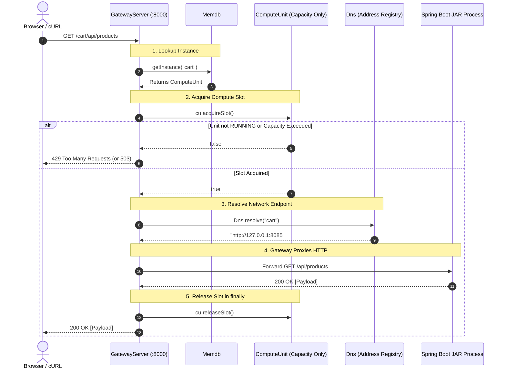

# Architecture Plan: Compute Capacity Leasing & Gateway DNS Resolution

## Goal Description
Implement a clean, decoupled architecture where:
1. **`ComputeUnit` is 100% network-blind**: It only manages lifecycle state and compute capacity (available request slots/permits).
2. **`Dns` is the single source of truth for network resolution**: It maps instance IDs and names to `http://127.0.0.1:<port>`.
3. **`GatewayServer` coordinates ingress**: It acquires a compute slot from the `ComputeUnit`, looks up the target address from `Dns`, proxies the HTTP request, and releases the slot upon completion in a `finally` block.
4. **`JarExecutorRuntime` is a pure process manager**: All HTTP proxying logic is removed from the runtime.

---

## User Review Required

> [!IMPORTANT]
> **No Network Details in `ComputeUnit`**:
> Under this plan, `ComputeUnit` will not know its IP, port, or URL. It only implements `GatewayServerIntegration` with `acquireSlot()` and `releaseSlot()`.

> [!NOTE]
> **Capacity Limits**:
> For now, each `ComputeUnit` will use a default concurrency limit (e.g., 4 concurrent request slots via `Semaphore(4)`). In the future, this number will be driven by the unit's resource tier.

---

## Request Flow Architecture



---

## Proposed Changes

### Component 1: Gateway Integration Interface
#### [MODIFY] org.cloudServices.shared.interfaces.GatewayServerIntegration.java
Replace generic runnable execution / dispatch with capacity slot management:
```java
package org.cloudServices.shared.interfaces;

public interface GatewayServerIntegration {
    /**
     * Attempts to acquire an execution slot on this unit.
     * @return true if a slot was granted and the unit is RUNNING; false otherwise.
     */
    boolean acquireSlot();

    /**
     * Releases an execution slot back to the unit.
     */
    void releaseSlot();
}
```

---

### Component 2: Compute Unit
#### [MODIFY] org.cloudServices.infra.computeUnit.ComputeUnit.java
* **Remove**: `dispatch(...)`, `sendError(...)`, and all HTTP imports (`com.sun.net.httpserver.*`, `HttpURLConnection`, etc.).
* **Add**: A `Semaphore capacity` (defaulting to e.g. 4 permits).
* **Implement**:
  ```java
  @Override
  public boolean acquireSlot() {
      if (this.state != ComputeUnitState.RUNNING) {
          return false;
      }
      return capacity.tryAcquire();
  }

  @Override
  public void releaseSlot() {
      capacity.release();
  }
  ```

---

### Component 3: Service Discovery (DNS)
#### [MODIFY] org.cloudServices.global.dns.Dns.java
Ensure `Dns` stores complete absolute URLs (`http://127.0.0.1:<port>`) and maps both UUID and Name:
```java
case COMPUTE_UNIT_RESERVED -> {
    if (event.service() instanceof ComputeUnit cu) {
        String targetUrl = "http://127.0.0.1:" + cu.getPort();
        dnsRegistry.put(cu.getId().toString(), targetUrl);
        if (cu.getName() != null && !cu.getName().isBlank()) {
            dnsRegistry.put(cu.getName(), targetUrl);
        }
    }
}

case COMPUTE_UNIT_KILLED, COMPUTE_UNIT_RELEASED -> {
    if (event.service() instanceof ComputeUnit cu) {
        dnsRegistry.remove(cu.getId().toString());
        if (cu.getName() != null) {
            dnsRegistry.remove(cu.getName());
        }
    }
}
```

---

### Component 4: Workload Runtime
#### [MODIFY] org.cloudServices.infra.runtimes.JarRuntime.JarExecutorRuntime.java
* **Remove**: `forwardRequest(...)`, `sendError(...)`, and HTTP imports.
* Revert to pure process and port management.

---

### Component 5: Gateway Server
#### [MODIFY] org.cloudServices.servers.GatewayServer.java
* Inspects URL path: `/{instanceId}/[subpath]`.
* Fetches `GatewayServerIntegration si = Memdb.getInstance(instanceId)`.
* Calls `si.acquireSlot()`:
  * If `false`: returns `429 Too Many Requests` (or `503 Service Unavailable`).
* In a `try ... finally { si.releaseSlot(); }` block:
  * Queries `String backendUrl = Dns.resolve(instanceId)`.
  * If `null`: returns `502 Bad Gateway`.
  * Forwards HTTP traffic via `proxyHttp(exchange, backendUrl + targetPath)` and streams response.

---

## Verification Plan

### Automated Tests
* Validate compilation of all modules using `mvn test-compile`.

### Manual Verification
1. Launch daemon:
   ```powershell
   mvn exec:java -Dexec.mainClass="org.cloudServices.Main"
   ```
2. Create and run a unit:
   ```powershell
   .\cld cu create cart jar target\my-spring-app.jar
   .\cld cu run cart
   ```
3. Verify DNS entry:
   Check that `Dns.resolve("cart")` maps to `http://127.0.0.1:8081`.
4. Send an HTTP request via the gateway:
   ```powershell
   curl http://localhost:8000/cart/api/test
   ```
   *Verify that:*
   * `cu.acquireSlot()` is called.
   * Target URL is resolved from `Dns`.
   * HTTP 200 OK is returned from Spring Boot.
   * `cu.releaseSlot()` is executed in `finally`.
5. Verify Capacity Rejection:
   Simulate exceeding the unit's capacity permits and verify `429 Too Many Requests` is returned.
